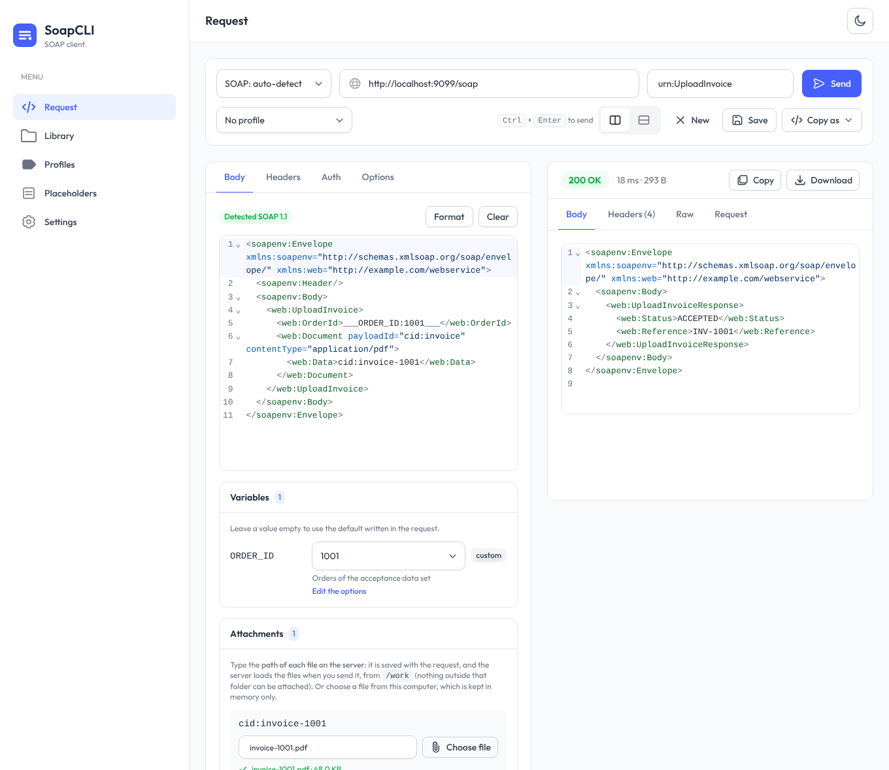

# SoapCLI

<p align="center">
  
</p>

`SoapCLI` is a small tool for sending SOAP requests over HTTP/HTTPS: a quick, scriptable alternative to a GUI client for
everyday calls. Use it from the **command line**, from a **web UI** that ships inside the same JAR, or from a **Docker
image** that does both.

<p align="center">
  
</p>

- **Simple** – one JAR (Java 11+), straightforward options, one dependency (Jackson, to read profiles).
- **Script-friendly** – the response body is the only thing on stdout, the HTTP status goes to stderr, and the exit code
  tells you what happened. Colour is only used on a terminal.
- **Flexible** – SOAP 1.1 and 1.2 (auto-detected), custom headers, Basic/Bearer auth, client certificates and custom
  trust stores, HTTP/SOCKS proxies, MTOM attachments, placeholders and per-environment profiles.
- **A web UI, embedded** – `java -jar SoapCLI.jar serve` opens a professional [TailAdmin](https://tailadmin.com)-based
  client: XML editor, variables (with dropdowns of options) and attachments (detected from the request) right under the
  editor, server profiles you can inspect and edit, history and a library, light and dark themes. Everything it needs is inside the JAR; the calls are made by the
  server, so they reach anything that machine reaches, with its client certificates, proxies and profiles.
- **Docker** – one image, the UI by default and the command line client on demand, for machines that have Docker but not
  Java.

---

## Quick start

### Get it

Download `SoapCLI-<version>.jar` from the [releases page](https://github.com/marcemv90/SoapCLI/releases), or build it
(needs JDK 11+ and Maven):

```bash
mvn clean package
```

This runs the tests and produces `target/SoapCLI.jar`, which includes all dependencies.

### Run

```bash
java -jar target/SoapCLI.jar --help
```

### Example call

```bash
java -jar SoapCLI.jar --endpoint https://example.com/soap --request-file request.xml
```

```text
HTTP 200 OK (143 ms, 312 bytes)          <- stderr
<soapenv:Envelope ...>                   <- stdout: the formatted response
  ...
```

Typical variations:

```bash
# SOAP 1.1 service that wants a SOAPAction (the version is read from the Envelope namespace)
java -jar SoapCLI.jar --endpoint https://example.com/soap --request-file request.xml --soap-action urn:GetOrder

# Use a saved profile for an environment, override one value
java -jar SoapCLI.jar --profile acceptance --request-file request.xml --arg ORDER_ID=42

# See exactly what would be sent, without sending it
java -jar SoapCLI.jar --profile acceptance --request-file request.xml --dry-run
```

### Web UI

```bash
java -jar SoapCLI.jar serve          # then open http://127.0.0.1:8080
```

Write or paste a request, fill in its variables, choose a file for each `cid:` it refers to, press **Send**. The call is
made by the SoapCLI server (so no CORS to worry about), which also brings client certificates, proxies and
[profiles](https://marcemv90.github.io/SoapCLI/cli-profiles/), which you can read and edit in the UI. See the
[Web UI documentation](https://marcemv90.github.io/SoapCLI/web-ui/).

### Docker

```bash
docker run -d -p 127.0.0.1:8080:8080 ghcr.io/marcemv90/soapcli                  # the web UI (default)
docker run --rm -v "$PWD:/work" ghcr.io/marcemv90/soapcli \
  --endpoint https://example.com/soap --request-file request.xml                # the command line client
```

The image runs on Intel/AMD and ARM (Apple Silicon) machines. For a shared server: set a login and the allowed destinations,
and put it behind HTTPS. See the
[Docker documentation](https://marcemv90.github.io/SoapCLI/docker/) and `compose.yaml`.

### Exit codes

| Code | Meaning |
|------|---------|
| 0 | the server answered with HTTP 2xx |
| 1 | bad command line, profile, file or keystore (nothing was sent) |
| 2 | the request could not be delivered (DNS, connection, timeout, TLS, proxy) |
| 3 | the server answered with another status (4xx, 5xx / SOAP fault, a redirect that was not followed) |

---

## Documentation

Full documentation (usage, options, profiles, TLS, examples, FAQ...) is available on GitHub Pages:

https://marcemv90.github.io/SoapCLI/

If you are upgrading from the first version, read the [changelog](docs/changelog.md): a few behaviours changed on
purpose (most notably the exit codes).

### Project layout

```text
src/main/java/io/github/marcemv90/soapcli/
  core/   the SOAP client: request building, HTTP transport, TLS, proxy, profiles, XML helpers.
          No console I/O and no System.exit, so it is shared by both front ends.
  cli/    the command line front end: option parsing, output, colours, exit codes.
  web/    the web server (JDK built-in, no extra dependency): JSON API, static files, login, destination policy.
src/main/resources/web/   the compiled web UI, embedded in the JAR (generated: see web-ui/).
src/test/java/...   JUnit 5 tests, including real TLS / mutual TLS / authenticating-proxy tests on local sockets.
web-ui/             source of the web UI (React, TypeScript, Tailwind, TailAdmin) and its tests.
Dockerfile, compose.yaml   the image: web UI by default, command line client on demand.
docs/               MkDocs site.
```

The compiled UI is committed, so `mvn clean package` needs neither Node nor network access. To change the interface, see
[web-ui/README.md](web-ui/README.md).

### Third-party software

The web UI is based on the free [TailAdmin](https://tailadmin.com) template (MIT) and bundles the Outfit font (SIL OFL)
and a set of open-source npm packages; the Java side uses Jackson (Apache 2.0). Licences and notices are in
[THIRD_PARTY_NOTICES.md](THIRD_PARTY_NOTICES.md).

### Building and previewing the documentation

The site is built from `docs/` with [MkDocs](https://www.mkdocs.org/) and the
[Material for MkDocs](https://squidfunk.github.io/mkdocs-material/) theme and is deployed by
`.github/workflows/gh-pages.yml`. To preview it locally with Docker:

```bash
docker build -f Dockerfile.docs -t soapcli-docs .
docker run --rm -p 8000:8000 -v "$(pwd)":/docs soapcli-docs
```

Then open http://localhost:8000/.

---

## DISCLAIMER

This project is being developed by a monkey with a shotgun (me) with the help of an AI agent. It is your responsibility
to test the code and ensure it works as expected in your environment before using it in production or critical systems.
