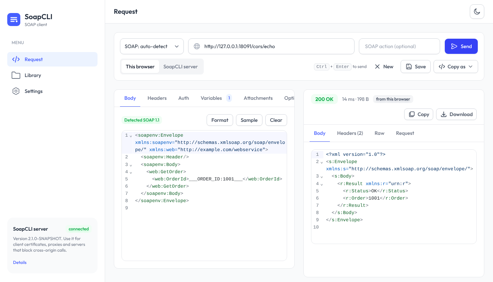
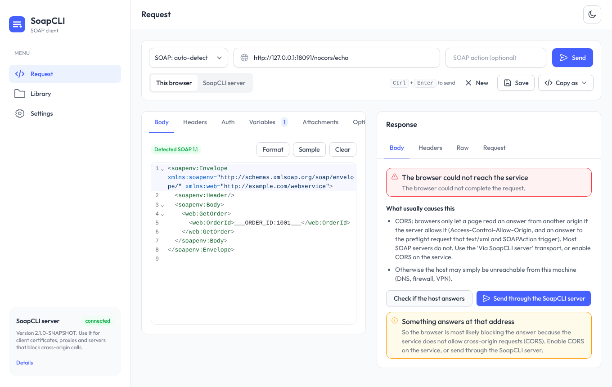

# Web UI

SoapCLI includes a browser client for the same engine as the command line: write or paste a request, press **Send**,
read the answer. It is meant to replace a heavy GUI client for everyday calls, and to be easy to share with a team.



- Built with [TailAdmin](https://tailadmin.com) (React, Tailwind CSS); light and dark themes; works on a phone.
- **Everything is inside the jar.** No CDN, no font download, no extra install, and it works with no internet access.
- Calls are made **from your browser by default**, so it reaches whatever your machine can reach: `localhost`, the
  company network, a VPN.

## Starting it

```bash
java -jar SoapCLI.jar serve
```

Open <http://127.0.0.1:8080>. By default it listens on this machine only. See [Docker](docker.md) to run it as a
container, and [Sharing it with a team](#sharing-it-with-a-team) before exposing it on a network.

```bash
java -jar SoapCLI.jar serve --port 9000
java -jar SoapCLI.jar serve --help          # every option
```

## Two ways to send a request

Next to the **Send** button you choose where the call is made from:

| | **This browser** (default) | **SoapCLI server** |
|---|---|---|
| Who makes the call | Your browser, on your machine | The SoapCLI process that served this page |
| Reaches | Anything your machine reaches | Anything the server's machine reaches |
| CORS | **Required** (see below) | Not involved |
| Client certificates, trust stores, proxies | No: only what the browser itself trusts | Yes, through [profiles](cli-profiles.md) |
| Skip TLS checks | No | Yes, unless the administrator disabled it |
| Headers such as `Host`, `Cookie` | The browser refuses to send them | Yes |
| Request encodings | UTF-8 and ISO-8859-1 | Any |
| Redirects | Browser behaviour; where they go is hidden | You control them |
| Server profiles and their secrets | No | Yes |
| Needs a SoapCLI server | **No**: it also works from plain static files | Yes |

Use **This browser** when you want to reach something that only your machine can reach, or when there is no server at
all. Use **SoapCLI server** for client certificates, proxies, self-signed servers, or services that do not allow CORS.

### CORS: why a call from the browser can fail

A web page may only read an answer from another address if that service allows it with `Access-Control-Allow-*` headers.
A SOAP call (`Content-Type: text/xml` plus a `SOAPAction` header) also makes the browser ask first, with a "preflight"
`OPTIONS` request. **Most SOAP servers do not answer those headers**, and a page has no way around that: it is a browser
rule, not a SoapCLI limit.

When it happens you see:



- **Check if the host answers** tells "something answers, but the browser blocks it (CORS)" from "nothing answers there".
- **Send through the SoapCLI server** repeats the call from the server, which is not subject to CORS (available when the
  page was served by a SoapCLI server).
- Or enable CORS on the service (for the origin of this page, and for the `Content-Type`, `SOAPAction` and
  `Authorization` request headers).

Other things that stop a browser: a page served over **HTTPS cannot call `http://` URLs** (mixed content; `localhost` is
exempt), and a self-signed certificate is rejected unless you open the URL once in a tab and accept it.

## Using it

**Endpoint bar.** Pick the SOAP version (auto-detect reads the namespace of your `Envelope`), type the URL, optionally the
**SOAP action**, and press **Send** or <kbd>Ctrl</kbd>+<kbd>Enter</kbd>. SoapCLI puts the action where each version
expects it: the `SOAPAction` header for SOAP 1.1, the `action` parameter of the `Content-Type` for 1.2
([details](cli-soap-versions.md)). **Save** keeps the request in the Library, **New** starts a blank one, and **Copy as…**
generates commands (see below).

**Request tabs**

- **Body**: an XML editor with highlighting, folding and line numbers. *Format* pretty-prints it, *Sample* loads an example.
- **Headers**: add any header; disabled rows are kept but not sent. Headers a browser cannot set are flagged.
- **Auth**: none, Basic or Bearer. Credentials are never stored (see [Your data](#your-data)).
- **Variables**: every `___NAME:default___` in the request is listed here with a field, so you can change a value without
  editing the XML ([placeholders](cli-placeholders.md)).
- **Attachments**: upload files with the button or by dragging them in, give each a CID, and refer to it in the request
  as `cid:CID`. By default the file is inlined as Base64; turn on **MTOM** to send it as a binary MIME part
  ([details](cli-attachments.md)). Attachments live in memory only, so they are not kept when you reload or open a saved
  request. Through the server, the request (with its attachments in Base64) must fit the server's limit, 25 MB by default
  (`--max-body-mb`); from the browser there is no limit besides memory.
- **Options**: timeout, follow redirects, skip TLS checks (server transport only).

**Response panel.** The status badge (green 2xx, amber 3xx, red 4xx/5xx; a SOAP fault is normally a red 500 with the
fault in the body), the time and the size; tabs for the formatted **Body**, the **Headers**, the **Raw** text exactly as
decoded, and the **Request** that was built, with credentials masked, a list of warnings (a variable nothing uses, an
attachment nothing references, a header the browser would drop) and the XML as it will be sent. In *This browser* mode
the Request tab updates as you type, so you can check what will go out before sending; with the SoapCLI server, press
*Show the request* and the server builds it for you.

!!! note "Response headers from the browser"
    A browser only shows the response headers the service exposes with `Access-Control-Expose-Headers` (plus a few safe
    ones). Use the SoapCLI server transport to see them all.

**Copy as…** turns what is on screen into the equivalent `java -jar SoapCLI.jar …` command, a Docker command, or a `curl`
command (credentials become environment variables), and *Download request.xml* saves the body, so a call you tried here
is easy to repeat in a script.

**Library** keeps your *Saved* requests and the last 50 calls (*History*), searchable by name or URL, with *Export* and
*Import* of the saved ones as a JSON file. **Settings** holds the theme and the defaults for new requests.

## Server profiles

If the SoapCLI server has a [profiles file](cli-profiles.md), choose **SoapCLI server** and pick a profile: it supplies
the endpoint, headers, authentication, certificates, proxy and so on, and anything you fill in the form overrides it.
Secrets stay on the server: the browser only ever receives the profile with them masked, and `${VAR}` references are
expanded by the server from its own environment. The server reads the file on every request, so edits take effect
immediately. Profiles cannot be edited from the UI.

## Your data

Saved requests, the history, the draft you are working on and your settings live in **your browser's local storage**,
never on the server. **Passwords, tokens and attachment contents are never stored**: they are forgotten when you close
the tab. *Settings → Your data* can clear the history or delete everything.

## Sharing it with a team

A SoapCLI server makes HTTP requests on behalf of whoever can reach it, and can hold credentials in its profiles. Treat it
like any internal tool that can call other systems:

- **Set a login**: `--ui-user` with `--ui-password` or `--ui-password-env` (or `SOAPCLI_UI_USER` / `SOAPCLI_UI_PASSWORD`).
  It is HTTP Basic, so put the server behind **HTTPS** (a reverse proxy; see [Docker](docker.md#behind-a-reverse-proxy)).
- **Restrict where it can call**: `--allow-host '*.corp.example.com' --allow-host 10.1.*`. Redirects are checked too, so
  an allowed host cannot bounce a request to a forbidden one.
- **Remove the dangerous switch** if you want: `--no-insecure-tls` hides "Skip TLS certificate checks".
- It limits request and response sizes (`--max-body-mb`, `--max-response-mb`) and caps timeouts (10 minutes).
- Listening on a non-loopback address without a login prints a warning at startup.

What the server does for you without being asked: it refuses cross-site requests (the API only accepts
`application/json`, which a browser cannot send cross-site without a CORS preflight that the server never approves),
checks the `Host` header when it listens on `localhost` only (a defence against DNS rebinding), and sends a strict
Content-Security-Policy: scripts may only come from the server itself.

| Option | Environment variable | Default |
|---|---|---|
| `--host` | `SOAPCLI_HOST` | `127.0.0.1` |
| `--port` | `SOAPCLI_PORT` | `8080` |
| `--profile-file` | `SOAPCLI_PROFILE_FILE` | `~/.config/soap-cli-profiles.json` |
| `--ui-user`, `--ui-password`, `--ui-password-env` | `SOAPCLI_UI_USER`, `SOAPCLI_UI_PASSWORD` | no login |
| `--allow-host` (repeatable) | `SOAPCLI_ALLOWED_HOSTS` (comma separated) | any host |
| `--no-insecure-tls` | `SOAPCLI_NO_INSECURE_TLS=true` | allowed |
| `--max-body-mb` | `SOAPCLI_MAX_BODY_MB` | 25 |
| `--max-response-mb` | `SOAPCLI_MAX_RESPONSE_MB` | 20 |

Command line options override the environment. `java -jar SoapCLI.jar healthcheck` exits 0 if a UI answers on this
machine's port (the Docker image uses it).

## Without a SoapCLI server

The interface is a set of static files (`web/` inside the jar). Served from any web server, it works in *This browser*
mode: the SoapCLI server option is disabled, and *Settings* explains how to get one. Handy on a machine where you can
open a page but not run Java.

## Keyboard

| Keys | Action |
|---|---|
| <kbd>Ctrl</kbd>/<kbd>⌘</kbd> + <kbd>Enter</kbd> | Send |
| <kbd>Esc</kbd> | Close the menu on a small screen |

## Troubleshooting

| Symptom | Cause |
|---|---|
| "The browser could not reach the service" | Usually CORS: see above. Use *Check if the host answers*. |
| The *SoapCLI server* option is greyed out | The page was not served by a SoapCLI server. |
| Server mode: "The host … is not allowed by this server's policy" | The administrator restricted the destinations (`--allow-host`). |
| Server mode: "larger than 25 MB" | Raise `--max-body-mb`, or send the request from the browser. |
| A header is flagged "browsers do not let a page set …" | `Host`, `Cookie`, `User-Agent`… cannot be set from a page; use the server transport. |
