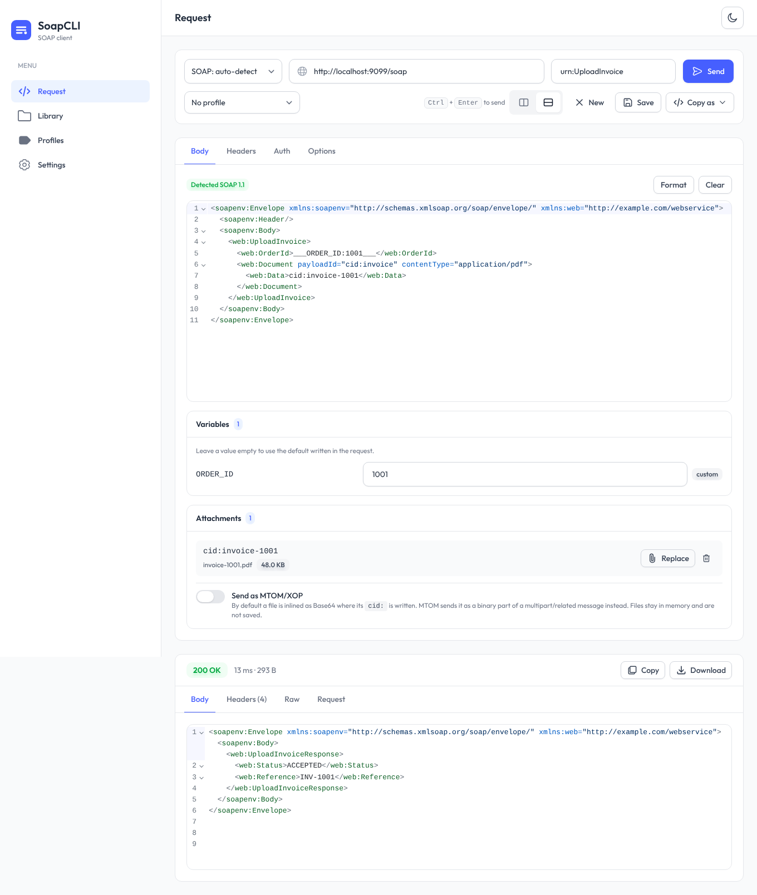
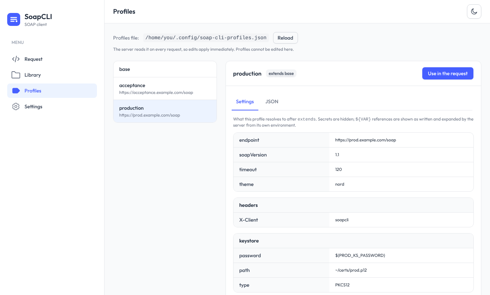
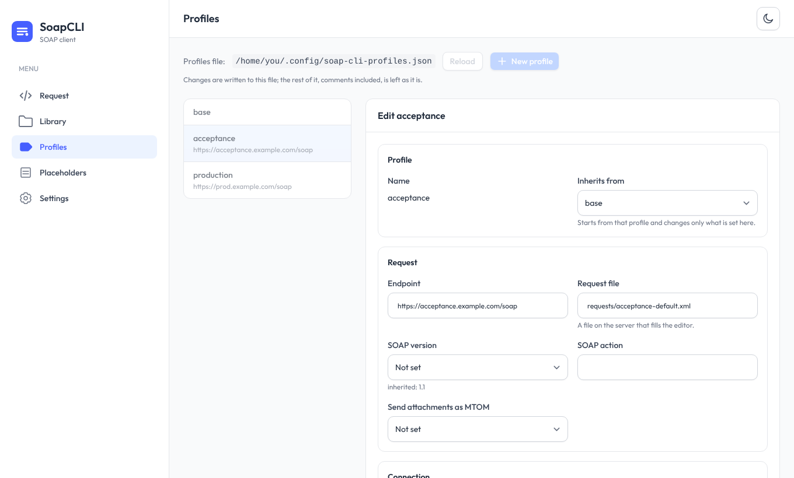
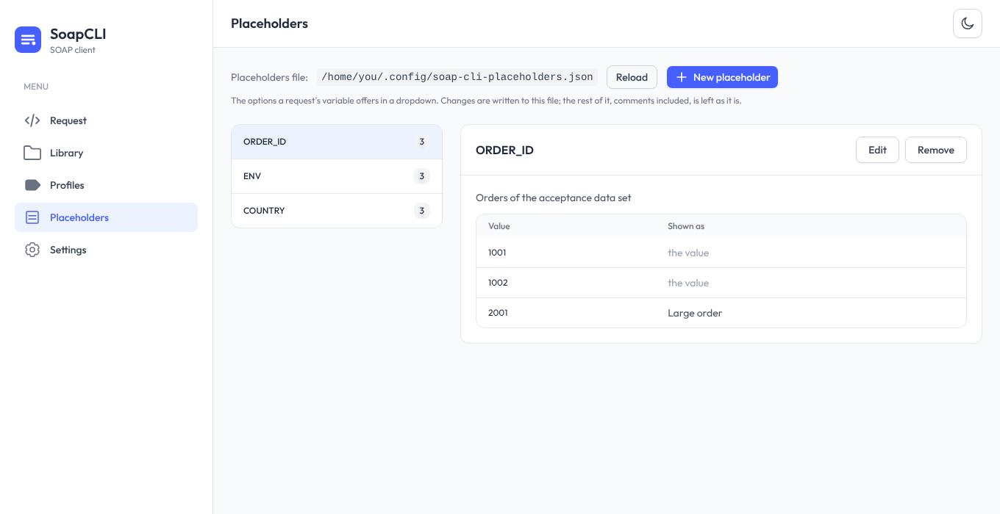

# Web UI

SoapCLI includes a browser client for the same engine as the command line: write or paste a request, press **Send**,
read the answer. It is meant to replace a heavy GUI client for everyday calls, and to be easy to share with a team.


- Built with [TailAdmin](https://tailadmin.com) (React, Tailwind CSS); light and dark themes; works on a phone.
- **Everything is inside the jar.** No CDN, no font download, no extra install, and it works with no internet access.
- Every call is made **by the SoapCLI server** that serves the page, so it reaches whatever the machine running it can
  reach (`localhost`, the company network, a VPN) and can use that machine's client certificates, trust stores, proxies and
  [profiles](cli-profiles.md). Nothing depends on the service allowing cross-origin (CORS) calls.

## Starting it

```bash
java -jar SoapCLI.jar serve
```

Open <http://127.0.0.1:8080>. By default it listens on this machine only. See [Docker](docker.md) to run it as a
container, and [Sharing it with a team](#sharing-it-with-a-team) before exposing it on a network.

```bash
java -jar SoapCLI.jar serve --port 9000
java -jar SoapCLI.jar serve --help          # every option
```

## Using it

**Endpoint bar.** Pick the SOAP version (auto-detect reads the namespace of your `Envelope`), type the URL, optionally the
**SOAP action**, and press **Send** or <kbd>Ctrl</kbd>+<kbd>Enter</kbd>. SoapCLI puts the action where each version
expects it: the `SOAPAction` header for SOAP 1.1, the `action` parameter of the `Content-Type` for 1.2
([details](cli-soap-versions.md)). On the second row: the **server profile** to use, if the server has any (*View profile*
opens its configuration), the **layout** of the page, **New** to start a blank request, **Save** to keep it in the Library,
and **Copy as…** to generate commands (see below).

**Layout.** The request and the response can sit **side by side** (the default, on screens wide enough) or **stacked**,
with the response under the request. Choose with the two-pane buttons next to *New*, or in *Settings*; the choice is
remembered.



**Request tabs**

- **Body**: an XML editor with highlighting, folding and line numbers (*Format* pretty-prints it). Under the editor, the
  two things the body refers to are listed, so you never leave the screen:
    - **Variables**: every `___NAME:default___` in the request gets a field, so you can change a value without editing
      the XML ([placeholders](cli-placeholders.md)). A field left empty uses the default written in the request. A
      placeholder that has [options](#placeholder-options) is a **dropdown** instead: the request's own default, each
      option, and *Custom value…* to type another one.
    - **Attachments**: every `cid:NAME` written as the **text** of an element is detected automatically, and you give
      the file for it. A `cid:` inside an **attribute** is not an attachment and is not listed. In
      ```xml
      <payload payloadId="cid:message" contentType="text/xml">
         <value>cid:1234</value>
      </payload>
      ```
      only `1234` appears, because `message` is the value of an attribute. You give each file in one of two ways.
      **A path on the server** is the usual one: type it, and the field says at once whether the server found the file.
      The path **is saved with the request**, so a saved request, or one from the history, sends its files again without
      choosing them; when you press *Send* the server first loads them, in a dialog with the progress, and then the request
      goes out ([details](#attachments-by-path)). **A file from this computer** (*Choose file*, or drag it onto the row)
      is sent with that request but kept in memory only, so it is **not saved**. By default the file is inlined as Base64
      where the `cid:` is written; turn on **MTOM** to send it as a binary MIME part ([details](cli-attachments.md)). A
      file whose `cid:` you delete from the body is kept (retyping the reference brings it back) but is **not sent**.
      The request, with the files from this computer in Base64, must fit the server's limit, 25 MB by default
      (`--max-body-mb`).
- **Headers**: add any header; disabled rows are kept but not sent.
- **Auth**: none, Basic or Bearer. Credentials are never stored (see [Your data](#your-data)).
- **Options**: timeout, follow redirects, skip TLS checks (unless the administrator disabled it).

**Response panel.** The status badge (green 2xx, amber 3xx, red 4xx/5xx; a SOAP fault is normally a red 500 with the
fault in the body), the time and the size; tabs for the formatted **Body**, the **Headers**, the **Raw** text exactly as
decoded, and the **Request** that was built, with credentials masked, a list of warnings (a variable nothing uses, an
attachment nothing references) and the XML as it was sent. Press *Show the request* to have the server build it before you
send.

**Copy as…** turns what is on screen into the equivalent `java -jar SoapCLI.jar …` command, a Docker command, or a `curl`
command (credentials become environment variables; the server builds the request for it, so headers that come from a
profile appear as `****` for you to fill in), and *Download request.xml* saves the body, so a call you tried here is easy
to repeat in a script.

**Library** keeps your *Saved* requests and the last 50 calls (*History*), searchable by name or URL, with *Export* and
*Import* of the saved ones as a JSON file. On a server that uses [workspaces](workspaces.md) the saved requests are the
workspace's, kept on the server and shared with everyone who opens it. **Profiles** and **Placeholders** show, and can edit, the server's profiles and the options of the placeholders (below). **Settings** holds the theme,
the layout, the defaults for new requests and the details of the server (version, allowed destinations, limits).

## Server profiles

If the SoapCLI server has a [profiles file](cli-profiles.md), pick a profile next to the endpoint: it supplies the
endpoint, headers, authentication, certificates, proxy and so on, and anything you fill in the form overrides it.



The **Profiles** page (in the menu, or *View profile* on the request page) shows each profile's configuration as the
server resolves it: the values after `extends`, in the order of the [documentation](cli-profiles.md#fields), with the
nested groups (`headers`, `args`, `keystore`, `proxy`...) as tables, and the same data as JSON. A profile that cannot be
resolved (for instance, one that extends a profile that does not exist) is marked with its error. From there, *Use in the
request* selects it, and *Load its request file* fills the editor with the profile's `requestFile`.

Secrets stay on the server: the browser only ever receives the profile with them masked (`****`), and `${VAR}`
references are shown as written and expanded by the server from its own environment. The server reads the file on every
request, so edits made by hand take effect immediately (press *Reload* to see them).

### Editing profiles

**Edit** opens a profile as a form, **New profile** creates one, and **Delete** removes it.



- The form edits what the profile **itself** says, not what it inherits. A field left empty shows what the profile would
  get from the one it extends (*inherited: 1.1*), and a group that is inherited (the proxy, the client certificate, the
  trust store) can be switched off for this profile (*Do not use the proxy that base defines*, which is written as
  `null`).
- **Secrets** never reach the page. A saved one shows as *saved*; *Change* lets you type a new value (leave it empty to
  remove the secret), and *Keep the saved one* undoes that. This holds for `authBasic`, `authBearer`, the passwords, and any
  header or variable whose name looks like a secret (`X-Api-Key`, `TOKEN`...).
- Settings the form does not know (a typo, or a setting of a newer version) are kept as they are.
- **The file is edited, not rewritten.** Only the profile you change is replaced: the other profiles, their formatting and
  the comments around them stay byte for byte as they were (comments *inside* the edited profile are lost). The file is
  replaced atomically, keeps its permissions and, if it is a symbolic link, stays one; a file that did not exist is created
  readable by its owner only.
- **Nobody's change is overwritten.** Every save quotes the revision of the file the form was made from; if the file
  changed since (by hand, or in another window), the save is refused and *Reload the file* gives up the edits and shows
  what is there now.
- **A profile that would not work is refused.** The same checks as when the profile is used run first (types, `extends`,
  loops), and a change must not break a profile that extends this one. A profile cannot be deleted while another extends
  it. Things worth knowing, such as a setting SoapCLI ignores, or a `${VAR}` that is not set on the server (so the types
  could not be checked), are shown after saving.

**Who can edit.** Editing a profile can send its credentials to another destination, or point it at any file of the
machine (`requestFile`, `attachments`, `keystore`), so it is not on for everybody:

| The server | Editing from the UI |
|---|---|
| listens on this machine only (the default, `127.0.0.1`) | **on**, if the file is writable |
| listens on a network address (and so does Docker, inside the container) | **off**, until you start it with `--allow-config-edit` |
| started with `--no-config-edit` | off |

The file must be writable too: with Docker, mount the folder with the profiles *without* `:ro`
([details](docker.md#profiles-and-secrets)). When editing is off the page says why, and everything can still be viewed
and used. Turn it on for a shared server only together with a login (`--ui-user`).

## Placeholder options

A placeholder (`___ENV:acceptance___`) can offer a **dropdown** of values instead of a text field. The options are not
part of a profile, because they belong to the placeholders, not to an environment: they live in a file of their own,
`~/.config/soap-cli-placeholders.json` by default (`--placeholders-file`, `SOAPCLI_PLACEHOLDERS_FILE`;
`/config/placeholders.json` in the Docker image). Like the profiles file, it accepts comments and trailing commas:

```json
{
  // Options for the placeholders of a request
  "placeholders": {
    "ENV": { "options": ["acceptance", "staging", { "value": "production", "label": "Production (careful)" }] },
    "COUNTRY": {
      "description": "Country code",
      "options": [{ "value": "ES", "label": "Spain" }, { "value": "NL", "label": "Netherlands" }]
    }
  }
}
```

An option is a value, or a `{ "value", "label" }` when the dropdown should show something friendlier than the value
(*Spain (ES)*). Options are matched by the name of the placeholder, in any request. The first choice of the dropdown is
always the request's own default, and *Custom value…* lets you type something that is not listed. A problem with one
entry (say, `options` is not a list) is reported on that entry and does not stop the others.



The **Placeholders** page edits the file, with the same rules as the profiles (who can edit, the revision check, the rest
of the file left alone): add a placeholder, give it options (one by one, or pasted as lines of `value` or
`value | label`), put them in order, and remove them. From a request, *Give it options* (or *Edit the options*) under a
variable opens the page on that placeholder. The command line client does not read this file: `--arg` takes any value.

## Attachments by path

A request can name each attachment by its **path on the server** instead of carrying the file, which is what makes it
possible to save a request together with its attachments: only the path is stored.

When you press *Send*:

1. the page asks the server to open each of the files (`POST /api/attachments/check`) one after the other, and a dialog
   shows every file with its state and how many of them are done;
2. if all of them load, the request is sent and the server reads the files itself;
3. if one cannot be loaded (not found, outside the allowed folder, too big) **nothing is sent**: the dialog stays open
   with the reason for each file, and offers *Close* and *Try again*. *Cancel* or <kbd>Esc</kbd> while it loads cancels
   the whole send.

The files never travel through the browser, so "loading" is the server opening and measuring each one; the dialog stays up
for at least half a second so that it can be read.

**Which folder.** The server only reads inside its **attachments folder**: the directory it was started in, unless you set
`--attachments-dir` (or `SOAPCLI_ATTACHMENTS_DIR`); in the Docker image it is `/work`. A relative path is relative to that
folder; an absolute path (or one starting with `~/`) must still end up inside it. `..` and symbolic links that leave the
folder are refused, with the same answer whether or not the file exists, so nothing outside can be explored. The rule
exists because, without it, anyone who can open the UI could make the server read any file it can and send it to any
destination. The start-up banner and *Settings* show the folder, and the server warns when it listens on a network address
without a folder chosen for this. To switch the feature off, point it at an empty folder.

**Limits.** The files attached by path count together against `--max-body-mb` (25 MB by default), because the server holds
them in memory to build the request. The `attachments` of a [profile](cli-profiles.md) are not affected: the administrator
wrote them, so they are not confined to this folder.

## Workspaces

A server started with `--workspaces-dir` keeps **one folder per team or project**, each with its own profiles, placeholder
options, attachments and saved requests, so that what one person saves is there for the next one. A switcher in the sidebar
chooses the workspace, the **Workspaces** page creates, opens and removes them, and every address names its workspace, so a link
to a saved request opens it for whoever follows it. See [Workspaces](workspaces.md) for the layout of the folders, the
settings an administrator has (`readOnly`, `allowedHosts`, `secrets.env`), who can do what, and how to use one from the
command line and from Docker.

## Your data

Saved requests, the history, the draft you are working on and your settings live in **your browser's local storage**,
never on the server. (With [workspaces](workspaces.md), the requests you save in a workspace are the exception: they are
files on the server, shared on purpose; the history and the draft are still the browser's, kept per workspace.) **Passwords, tokens and the contents of files are never stored**: they are forgotten when you close
the tab. The *path* of an attachment is stored with its request: that is what lets you save a request with its
attachments. *Settings → Your data* can clear the history or delete everything.

## Sharing it with a team

A SoapCLI server makes HTTP requests on behalf of whoever can reach it, and can hold credentials in its profiles. Treat it
like any internal tool that can call other systems:

- **Set a login**: `--ui-user` with `--ui-password` or `--ui-password-env` (or `SOAPCLI_UI_USER` / `SOAPCLI_UI_PASSWORD`).
  It is HTTP Basic, so put the server behind **HTTPS** (a reverse proxy; see [Docker](docker.md#behind-a-reverse-proxy)).
- **Restrict where it can call**: `--allow-host '*.corp.example.com' --allow-host 10.1.*`. Redirects are checked too, so
  an allowed host cannot bounce a request to a forbidden one.
- **Think before turning on editing** on a network address (`--allow-config-edit`): whoever can open the UI can then
  change a profile's endpoint and so receive its credentials ([details](#editing-profiles)). Only with a login.
- **Keep a team's files together** with [workspaces](workspaces.md): each has its own profiles, secrets and attachments folder,
  and can be limited to some destinations (`allowedHosts`) or made read-only. Everyone who can sign in sees every workspace,
  and what is saved in one is readable by all of them.
- **Choose the attachments folder** with `--attachments-dir`: people using the UI can attach, and so send to the
  destinations they may call, any file inside it ([details](#attachments-by-path)).
- **Remove the dangerous switch** if you want: `--no-insecure-tls` hides "Skip TLS certificate checks".
- It limits request and response sizes (`--max-body-mb`, `--max-response-mb`) and caps timeouts (10 minutes).
- Listening on a non-loopback address without a login prints a warning at startup.

What the server does for you without being asked: it refuses cross-site requests (the API only accepts
`application/json`, which a browser cannot send cross-site without a CORS preflight that the server never approves),
checks the `Host` header when it listens on `localhost` only (a defence against DNS rebinding), and sends a strict
Content-Security-Policy: scripts may only come from the server itself.

| Option | Environment variable | Default |
|---|---|---|
| `--host` | `SOAPCLI_HOST` | `127.0.0.1` |
| `--port` | `SOAPCLI_PORT` | `8080` |
| `--profile-file` | `SOAPCLI_PROFILE_FILE` | `~/.config/soap-cli-profiles.json` |
| `--ui-user`, `--ui-password`, `--ui-password-env` | `SOAPCLI_UI_USER`, `SOAPCLI_UI_PASSWORD` | no login |
| `--allow-host` (repeatable) | `SOAPCLI_ALLOWED_HOSTS` (comma separated) | any host |
| `--no-insecure-tls` | `SOAPCLI_NO_INSECURE_TLS=true` | allowed |
| `--placeholders-file` | `SOAPCLI_PLACEHOLDERS_FILE` | `~/.config/soap-cli-placeholders.json` |
| `--workspaces-dir` | `SOAPCLI_WORKSPACES_DIR` | no workspaces. Replaces the three file options above ([details](workspaces.md)) |
| `--allow-config-edit` / `--no-config-edit` | `SOAPCLI_ALLOW_CONFIG_EDIT=true` / `false` | on only if listening on this machine |
| `--attachments-dir` | `SOAPCLI_ATTACHMENTS_DIR` | the working directory (`/work` in Docker) |
| `--max-body-mb` | `SOAPCLI_MAX_BODY_MB` | 25 |
| `--max-response-mb` | `SOAPCLI_MAX_RESPONSE_MB` | 20 |

Command line options override the environment. `java -jar SoapCLI.jar healthcheck` exits 0 if a UI answers on this
machine's port (the Docker image uses it).

## Without a SoapCLI server

The interface is a set of static files (`web/` inside the jar), but everything it does goes through the server's API: a copy
served from anywhere else shows a notice ("No SoapCLI server behind this page") and cannot send. Start `serve` and open
the address it prints.

## Keyboard

| Keys | Action |
|---|---|
| <kbd>Ctrl</kbd>/<kbd>⌘</kbd> + <kbd>Enter</kbd> | Send |
| <kbd>Esc</kbd> | Close the menu on a small screen |

## Troubleshooting

| Symptom | Cause |
|---|---|
| "No SoapCLI server behind this page" | The page was not served by `serve`: open the address `serve` prints (or the container's port). |
| "Cannot reach the SoapCLI server" | The server stopped or the connection was lost. *Check the server again* once it is back. |
| "The host … is not allowed by this server's policy" | The administrator restricted the destinations (`--allow-host`). |
| "larger than 25 MB" | Raise `--max-body-mb` (the request, attachments included, is limited). |
| No *Edit* / *New profile* buttons | Editing is off (the page says why): a network address needs `--allow-config-edit`, and the file must be writable (Docker: no `:ro`). |
| "The profiles file changed since you opened it" | Someone (or you, by hand) changed it. *Reload the file* shows the current content; make the change again. |
| "This change would break the profile …" | A profile that extends this one would stop working. Fix that one first, or change both. |
| "There is no workspace '…'" | A link or a remembered choice names a workspace that was removed or renamed: pick another in the sidebar. |
| "This workspace is read-only" / the *Workspace* choice of *Save* is greyed out | The administrator set `"readOnly": true` in its `workspace.json`, or the folder is not writable (Docker: mount it without `:ro`), or the server runs with `--no-config-edit`. |
| "The saved request changed since you opened it" | Someone saved it meanwhile. Open it again, or use *Save as a new request*. |
| "… is outside the folder this server allows for attachments" | The path leaves the attachments folder (`--attachments-dir`; `/work` in Docker). Put the file inside it. |
| "The attachment file '…' was not found" | The path is read on the **server's** machine, not yours. With Docker, mount the files, e.g. `-v "$PWD/attachments:/work:ro"`. |
| An attachment you expected is not listed | Its `cid:` must be the text of an element, not the value of an attribute. |
| An attachment is listed as "no file chosen" | Choose a file for it; until then `cid:NAME` is sent as written. |
