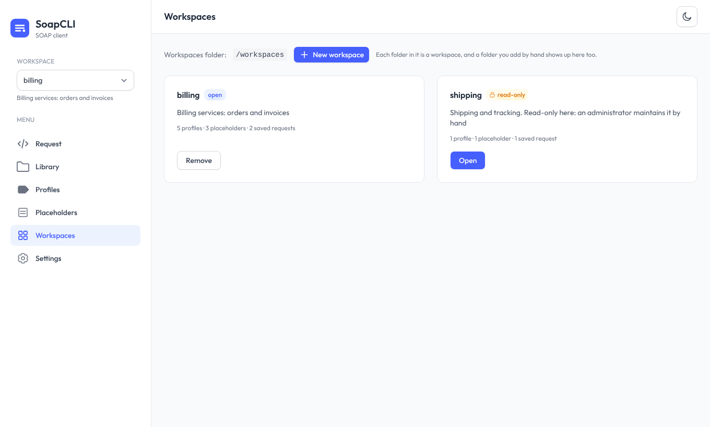
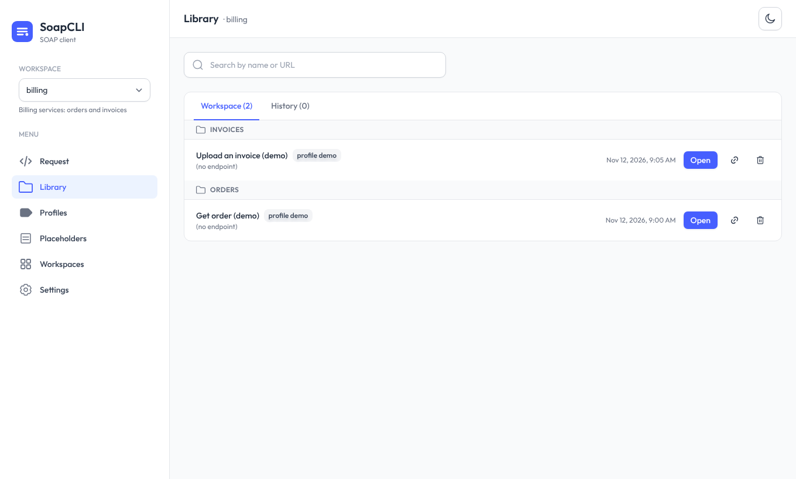
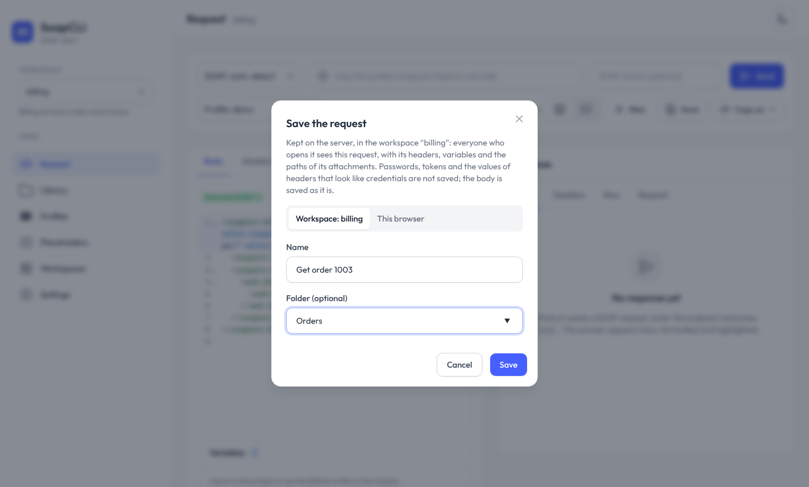

# Workspaces

A **workspace** is a folder on the server that holds everything one team or one project needs: its
[profiles](cli-profiles.md), the options of its [placeholders](web-ui.md#placeholder-options), the files it attaches, the
requests it has saved, and its secrets. Everybody who opens the web UI on that server sees the same workspaces, so a request
that one person saves is there for the next person, and a new colleague starts with the profiles that the team already has.

Without workspaces, a server has one set of files (`--profile-file`, `--placeholders-file`, `--attachments-dir`) and each
person's saved requests live in their own browser. Workspaces are optional: leave them off and nothing changes.



## Turning them on

Point the server at a folder; every folder inside it is a workspace.

```bash
mkdir workspaces
java -jar SoapCLI.jar serve --workspaces-dir ./workspaces        # or SOAPCLI_WORKSPACES_DIR=./workspaces
```

Create the first workspace from the **Workspaces** page of the UI, or just make a folder (`mkdir workspaces/billing`): a
folder you add by hand shows up at once, without restarting. A workspace is any folder whose name is made of letters, digits,
`.`, `_` and `-` (at most 64 characters, starting with a letter or a digit); anything else in the folder (a `.git`, a stray
file) is ignored.

`--workspaces-dir` **replaces** `--profile-file`, `--placeholders-file` and `--attachments-dir`: each workspace has its own, so
naming them on the command line next to it is refused. (The Docker image sets the matching environment variables for everybody;
those are simply not used when workspaces are on.)

## What is in a workspace

```text
workspaces/
  billing/
    workspace.json       optional: description, readOnly, allowedHosts
    profiles.json        the profiles (the same file format as everywhere else)
    placeholders.json    the options offered for placeholders (dropdowns)
    secrets.env          optional: NAME=value lines that the profiles refer to as ${NAME}
    attachments/         the only folder files can be attached from, by path
    requests/            the saved requests, one JSON file each
    templates/           by convention, the request files that profiles refer to (requestFile)
    certs/               by convention, where keystores and truststores go
  shipping/
    ...
```

Nothing is required: a workspace is created with `attachments/`, `requests/` and a `workspace.json`, and the other files appear
when something is saved into them. To back a workspace up, copy its folder; to move it to another server, copy it there.

### `workspace.json`

```json
{
  // What it is for, shown in the UI
  "description": "Billing services: invoices and orders",
  // true: it can be used but not changed from the UI (no saving, no editing profiles, no removing)
  "readOnly": false,
  // Narrows where this workspace may send, on top of --allow-host: never widens it
  "allowedHosts": ["*.billing.example.com"]
}
```

Comments and trailing commas are accepted. The file is read every time, so a change applies at once, and the UI never writes
to it after the workspace is created: it is where an administrator protects a workspace. If it cannot be read, the workspace is
treated as read-only **and nothing is sent from it** (a limit that cannot be read is not silently dropped).

### Profiles, and the paths in them

`profiles.json` is the same file as the command line's, with one difference: **a relative path in a profile starts in the
workspace folder**, not in the working directory. So the workspace is self-contained and can be moved:

```json
{ "profiles": { "acceptance": {
    "endpoint": "https://acc.billing.example.com/soap",
    "requestFile": "templates/order.xml",
    "keystore": { "path": "certs/client.p12", "password": "${KEYSTORE_PASSWORD}" },
    "authBasic": "${ACC_CREDENTIALS}"
} } }
```

`${NAME}` is read from `secrets.env` first and then from the server's environment, so a workspace can bring its own secrets
without restarting the server (see [Secrets](#secrets)). Profiles are edited from the UI under the same rules as always
([who can edit](web-ui.md#editing-profiles)), and the workspace's `readOnly` flag adds one more way to say no.

### Attachments

An attachment named by path is read from the `attachments/` folder **of the workspace that is open**, and nothing outside it can
be attached: not `..`, not an absolute path elsewhere, not a symbolic link that leaves it, and not another workspace's files
([details](web-ui.md#attachments-by-path)). The path is saved with the request, so a request that is shared sends its files
again for whoever opens it, from the same folder.

## Saved requests



In a workspace, **Save** asks where to keep the request: **the workspace** (on the server, shared with everyone who opens it) or
**this browser** (private, as before). A request saved in the workspace is a file in `requests/`:

```json
{
  "app": "soapcli",
  "version": 1,
  "name": "Get order",
  "folder": "Orders",
  "updatedAt": "2026-11-12T10:00:00Z",
  "draft": { "endpoint": "...", "body": "<soapenv:Envelope ...>", "headers": [...], "args": {...}, "attachments": [...], "profile": "acceptance" }
}
```



- **One file per request**, named after it (`get-order-k3f9a.json`), so two people saving different requests never touch each
  other's, a request can be copied or put under version control like any file, and an administrator can drop one in by hand.
  Comments and trailing commas are accepted when reading.
- **Folders** are a label to group requests in the Library (the *Folder* field of the save dialog). They are not directories.
- **Nobody's change is overwritten.** Opening a request remembers which version it was; saving over it quotes that version, and if
  someone saved in between the save is refused with the reason, and *Save as a new request* is still there. Removing a request
  works the same way.
- **A link to a request.** In the Library, the link button copies an address such as
  `https://soapcli.corp.example.com/#/request?w=billing&open=get-order-k3f9a`. Whoever follows it (after signing in) gets that
  request, in that workspace. Every address of the UI names its workspace (`?w=billing`), so the page you are on can be shared too.

!!! warning "A shared request is shared"
    Everyone who can open the workspace can read what is saved in it. The password and token of the *Auth* tab are never saved,
    and neither is the **value** of a header or a variable whose name looks like a credential (`Authorization`, `X-Api-Key`,
    `DB_PASSWORD`...): it is left empty and the save says so. The **body is saved as it is**, so a secret written in it (a WS-Security
    `UsernameToken`, say) would be shared; put credentials in a profile, whose secrets never reach the browser.

The history stays in the browser, as it is personal, but it is kept **per workspace**, and so is the request you are editing:
switching workspace brings back what you were doing there. A request saved in this browser before the server used workspaces is
still there under **Library → This browser**, and *Move to workspace* saves it into the open one (a profile the workspace does not
have is dropped when it is opened, with a notice).

## Secrets

`secrets.env` holds the values that the workspace's profiles refer to as `${NAME}`:

```text
# secrets of the billing team
ACC_CREDENTIALS=svc:s3cret
KEYSTORE_PASSWORD="change me"      # quotes keep spaces and # as they are
```

One `NAME=value` per line; `#` starts a comment, `export ` is accepted, and an unquoted value ends at a space followed by `#`. The file
is read every time the workspace is used. The UI **never** shows or changes it, and a profile only ever reaches the browser with its
secrets masked. Keep it out of version control and readable by the server's user only (`chmod 600`). A variable that is in the file
and in the server's environment takes the file's value, for that workspace only.

## Who can do what

| | Allowed when |
|---|---|
| Use a workspace (send, load requests, read profiles) | always (the login of the server, if there is one, applies to everything) |
| Save and remove requests of the library | the folder is writable, the workspace is not `readOnly`, and the server was not started with `--no-config-edit`. **Not** gated by `--allow-config-edit`: sharing requests is what workspaces are for |
| Edit profiles and placeholder options | as [before](web-ui.md#editing-profiles) (a server on a network address needs `--allow-config-edit`), and the workspace is not `readOnly` |
| Create and remove workspaces | the same as editing profiles, and the workspaces folder is writable |

**Removing a workspace never deletes it**: its folder is renamed to `.removed-<name>-<date>` in the same directory (which is no longer
a workspace), so everything in it can be put back by renaming it. A workspace marked `readOnly` cannot be removed from the UI at all.

All of this is behind the login of the server (`--ui-user`): there is one login for the whole server, so everyone who can sign in sees
every workspace. To keep a team's workspace from another team, run another server; a per-workspace access list is a possible future step.

## From the command line

The command line client can use a workspace too, so scripts and the UI share the same profiles and secrets:

```bash
java -jar SoapCLI.jar --workspaces-dir ./workspaces --workspace billing --profile acceptance --request-file order.xml
SOAPCLI_WORKSPACES_DIR=./workspaces java -jar SoapCLI.jar --workspace billing --list-profiles
```

`--workspace` makes `<workspaces>/billing/profiles.json` the profiles file (so it cannot be combined with `--profile-file`), reads
`secrets.env` for `${NAME}`, and starts the relative paths of the profile in the workspace folder. The rest of the command line is
unchanged. *Copy as…* in the UI writes this command for a request of a workspace.

## Docker

The image has an empty `/workspaces` folder, owned by the unprivileged user, and does not turn workspaces on by itself:

```bash
docker run -d -p 127.0.0.1:8080:8080 \
  -e SOAPCLI_WORKSPACES_DIR=/workspaces -v "$PWD/workspaces:/workspaces" \
  ghcr.io/marcemv90/soapcli
```

Mount it **without** `:ro` if the UI should be able to save requests and create workspaces, and make sure the container's user can
write to it (`chown 10001 workspaces`, or `--user "$(id -u):$(id -g)"`). Editing profiles from the UI on a container still needs
`SOAPCLI_ALLOW_CONFIG_EDIT=true` and a login, as [described](docker.md#profiles-and-secrets). A
[complete example](https://github.com/marcemv90/SoapCLI/tree/main/examples/workspaces) with two workspaces and a mock service is in the
repository.

The same CLI works in the container, with the same mount:

```bash
docker run --rm -e SOAPCLI_WORKSPACES_DIR=/workspaces -v "$PWD/workspaces:/workspaces:ro" -v "$PWD:/work" \
  ghcr.io/marcemv90/soapcli --workspace billing --profile acceptance --request-file order.xml
```

## The API

Everything a workspace has lives under `/api/workspaces/{name}/`, with the same endpoints that a server without workspaces has under
`/api/` (`profiles`, `placeholders`, `send`, `preview`, `attachments/check`, `info`...), plus the library:

| | |
|---|---|
| `GET /api/workspaces` | the workspaces, with how many profiles, placeholders and saved requests each has |
| `POST /api/workspaces/create`, `/remove` | `{"name", "description"}` / `{"name"}` |
| `GET /api/workspaces/{name}/requests` | the saved requests, without their bodies |
| `GET /api/workspaces/{name}/requests/{id}` | one, in full, with its `revision` |
| `POST /api/workspaces/{name}/requests/save` | `{"name", "folder", "draft"}` for a new one; add `"id"` and `"revision"` to change one |
| `POST /api/workspaces/{name}/requests/delete` | `{"id", "revision"}` |

On a server with workspaces the unscoped endpoints (`/api/send`...) answer `400` and say which address to use; on a server without
them, `/api/workspaces` says so and the unscoped ones work as they always did.
